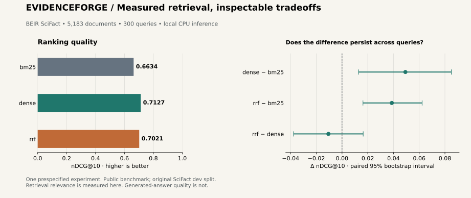
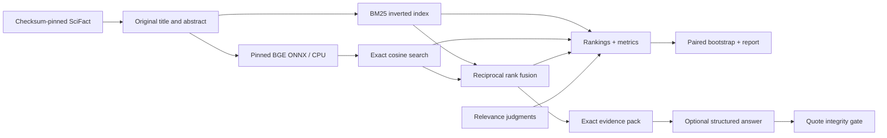

# EvidenceForge

[](https://github.com/JhoanFuentes/evidenceforge/actions/workflows/ci.yml)
[](pyproject.toml)
[](LICENSE)

**Measure retrieval. Inspect failures. Keep citation integrity separate from answer quality.**

EvidenceForge compares lexical retrieval, real local embeddings, and rank fusion on a public scientific-evidence benchmark. It preserves the configuration, model/data hashes, rankings, per-query scores, and paired uncertainty intervals needed to audit the result. A personal Applied AI engineering project by **Jhoan Fuentes**, developed with AI assistance.

[**Explore the interactive report**](https://jhoanfuentes.github.io/evidenceforge/) · [Repository](https://github.com/JhoanFuentes/evidenceforge) · [Technical review guide](docs/REVIEW_GUIDE.md) · [Guía de portafolio en español](docs/PORTFOLIO_ES.md)

The central question: **does a more complex retriever actually earn its latency and operational cost?**



## Measured result

One complete CPU run on **2026-11-16**, with all **5,183 documents and 300 queries**:

| System | nDCG@10 ↑ | Recall@10 ↑ | Median query latency ↓ |
| --- | ---: | ---: | ---: |
| BM25 | 0.6634 | 0.7876 | 26.59 ms |
| Dense BGE ONNX | **0.7127** | **0.8362** | 50.63 ms |
| RRF | 0.7021 | 0.8172 | 78.00 ms |

Dense minus BM25: **+0.0493 nDCG@10**, paired 95% bootstrap interval **[+0.0128, +0.0850]**. It improved 83 queries, tied 165 and regressed on 52. RRF minus dense was **−0.0106**, with interval **[−0.0377, +0.0164]**, crossing zero. This run does not establish an additional nDCG benefit from fusion; RRF did have the highest Recall@5 (0.7712). The choice depends on the evaluation objective and latency budget.

For a prototype prioritizing nDCG@10, these measurements support starting with dense retrieval and retaining BM25 as a cheap baseline. A different domain or operating point needs its own experiment. Intervals are conditional on these public queries and are not adjusted for multiple comparisons.

Corpus encoding took **743.85 seconds** on this machine; setup took 749.69 seconds. Query latency includes fresh query encoding for dense and serial component work for RRF, excluding setup. These are local measurements, not service SLOs. See the [published interactive report](https://jhoanfuentes.github.io/evidenceforge/), its [standalone HTML artifact](examples/scifact-v1/report.html), and [two inspectable cases](docs/CASE_STUDY.md).

## Review in 60 seconds

1. Open [the measured experiment](https://jhoanfuentes.github.io/evidenceforge/) in a browser and inspect the per-query comparisons. The [same report is included as standalone HTML](examples/scifact-v1/report.html).
2. Inspect [raw results](examples/scifact-v1/results.json): 5,183 documents, 300 queries, three systems, actual CPU model inference.
3. Run `python -m evidenceforge verify examples/scifact-v1/results.json` to recompute scores and bootstrap intervals from rankings and judgments, without downloading a model.
4. Run the offline demo below. A fabricated quote fails; an unsupported conclusion with a real quote **passes quote integrity**. That is an intentional demonstration of the validator's boundary.

This is a measured local research/engineering project. It is not a deployed production service, a SOTA claim, a claim-verification system, or a clinical tool. No live generative-model evaluation was executed for the included release.

For a deeper review, the [technical guide](docs/REVIEW_GUIDE.md) maps each engineering decision to its evidence and remaining limitation. Local validation recorded **105 passing tests** with the dense extra. The CI badge links to the current hosted workflow status; local test results and hosted checks are separate evidence.

## Quickstart — no key, no model download

Python **3.12+**. From the repository root:

```bash
python -m venv .venv
# macOS/Linux: source .venv/bin/activate
# PowerShell: .\.venv\Scripts\Activate.ps1
python -m pip install -e .
python -m evidenceforge demo --output runs/demo
python -m evidenceforge verify examples/scifact-v1/results.json
python -m unittest discover -s tests -v
```

The demo uses four authored documents and deterministic answers. It tests retrieval and citation boundaries; it is **not** an LLM benchmark. The included SciFact report is a separate, real retrieval experiment.

## Reproduce the model experiment

```bash
python -m pip install -e ".[dense]"
python -m evidenceforge download
python -m evidenceforge download-model
python -m evidenceforge benchmark --output runs/scifact-v1
python -m evidenceforge verify runs/scifact-v1/results.json
```

Use a fresh output directory for each run. The first two commands download public data and pinned model files; subsequent inference is local on CPU. The first run builds corpus embeddings; compatible later runs reuse the index. Runtime depends on hardware. Corpus, weights, indexes, and private runs are ignored by Git. The portable release excludes them.

For a fully resolved environment, use [uv](https://docs.astral.sh/uv/) with `uv sync --locked --extra dense --extra dev`, then prefix commands with `uv run --locked --extra dense`. The lock includes optional dependencies; CI separately tests the zero-dependency core.

The [frozen configuration](configs/scifact-v1.json) uses BM25 `k1=1.2, b=0.75`, 100 candidates per branch, RRF constant 60, BGE query instruction, four CPU threads, single-document batches, and 2,000 paired bootstrap samples with seed 42. There was no retrieval-quality tuning. Batch size was selected for CPU throughput on 16 unlabeled corpus documents before evaluating test queries. Changes after seeing these results should be labeled exploratory.

To regenerate the static figure: install `.[figures]`, then run `python scripts/plot_results.py examples/scifact-v1/results.json`. The figure is derived from saved measurements, not hand-entered scores.

## Retrieve an inspectable evidence pack

```bash
python -m evidenceforge search "How does oxidative stress affect cellular aging?" --method rrf --top-k 5 --output runs/evidence.json
```

`--method bm25` works without the dense extra/model. `dense` and `rrf` require the model download. The output contains the exact document IDs, original abstracts, scores, and a content fingerprint. Search does not decide whether evidence supports or contradicts the question. Scores are not probabilities of truth.

To inspect a query ID from the report, using the **saved rankings** and original local documents:

```bash
python -m evidenceforge case --query-id QUERY_ID --output runs/case.json
```

Run `download` first. This command checks the artifact and corpus compatibility, then exports the query, top documents per system, judged relevance and metrics. It does not re-run the model. A document without a positive judgment is not necessarily irrelevant. The exported source text stays in the ignored `runs/` directory.

## Optional generated answers

Set `OPENAI_API_KEY` in your environment and choose an explicit supported model ID, preferably a dated snapshot. Then:

```bash
python -m evidenceforge answer --pack runs/evidence.json --model YOUR_MODEL_ID --output runs/answer.json
```

**This command sends the query and retrieved text to OpenAI and can incur charges.** It performs one Responses API request with structured output, no automatic retries, bounded context/output, and `store=false`. It records returned token usage and response ID. A timeout can consume resources even when usage is unknown. An output-token cap is not a guaranteed monetary budget.

The adapter rejects malformed/refused/incomplete output, unknown document IDs, and fabricated quotations. An abstention must contain no answer or citations. Exact quote matching establishes textual occurrence only; **entailment, source truth, and causal use of evidence are not checked**. Prompt instructions are not a complete defense against document prompt injection. No agent tools or arbitrary URLs are executed.

Provider failures produce a sanitized error artifact before the command exits unsuccessfully; any known token usage is preserved. A content fingerprint detects accidental changes to an evidence pack, but does not authenticate its author.

## Architecture



Judgments enter the evaluator, not the retrievers. Dense index reuse checks document contents/order, encoder configuration, dependency versions, and matrix checksums. Vector files use NumPy with pickle disabled. A mismatch fails explicitly instead of silently reusing a stale index.

| Component | Engineering decision |
| --- | --- |
| Lexical baseline | Explicit Unicode tokenization, positive BM25 IDF, no stemming or stopword removal. This is not an exact reproduction of a published BM25 system. |
| Dense search | Exact cosine over 5,183 vectors, avoiding ANN approximation as another experimental variable. |
| Local model | `BAAI/bge-small-en-v1.5` alias resolves to the **Qdrant quantized ONNX derivative**, pinned to an immutable revision. 384 dimensions; 512-token truncation. |
| Fusion | Combine ranks rather than incompatible raw BM25/cosine scores. |
| Evaluation | Macro Recall@5/10, MRR@10, nDCG@10, paired query bootstrap, wins/ties/losses, full top-100 IDs. |
| Timing | Warm serial query encoding + retrieval; setup/indexing separate. RRF is summed component work. No production SLO claim. |
| Evidence | Original source text, explicit IDs, strict answer schema, deterministic quote checks. |
| Reporting | Self-contained HTML; no CDNs, telemetry, or document text in the included benchmark report. |

## What this demonstrates

- Designing an experiment whose negative results remain visible.
- Running and identifying actual local model artifacts, beyond an API wrapper.
- Separating retrieval quality, latency, operational integrity, and answer quality.
- Reproducible metrics, paired uncertainty, and inspectable regressions.
- Practical failure controls: index mismatch, corrupt artifacts, malformed provider output, citation fabrication, and untrusted text handling.

It does **not** establish production scale, enterprise deployment experience, business ROI, or a measured improvement in LLM factuality. Public benchmark contamination is unknown. BEIR's `test` here is the original SciFact **public dev** partition, not its hidden test. Relevant abstracts may support or contradict a claim. Do not extrapolate to other domains without another experiment.

## Two complementary engineering questions

[**HarnessLab**](https://github.com/JhoanFuentes/harnesslab) examines whether an agent runtime preserves its contracts during failures, interruptions and approval workflows. **EvidenceForge** examines whether a retriever finds useful evidence, using actual local model inference and inspectable per-query results. Together they make execution reliability and empirical retrieval quality independently reviewable. Neither result establishes the truth of a generated answer.

## Project map and reading path

- [Experiment protocol](docs/EXPERIMENT.md): hypotheses, split discipline, metrics, timing, limitations.
- [Technical review guide](docs/REVIEW_GUIDE.md): decisions, evidence and questions for an engineering review.
- [Data and model provenance](docs/DATA_AND_MODELS.md): download, upstream licenses, attribution, actual weights.
- [Spanish interview guide](docs/INTERVIEW_GUIDE_ES.md): defend design decisions and explain what the evidence establishes.
- [Portfolio notes](docs/PORTFOLIO_ES.md): concise CV wording and walkthrough.
- [Case study](docs/CASE_STUDY.md): a fusion regression and a recovery, using saved rankings.
- [Release notes](docs/RELEASE_NOTES.md): executed validation and the source/provenance boundary.
- `src/evidenceforge/`: small independent modules for data, retrieval, inference, grading, reports, and provider boundaries.
- `tests/`: network-free correctness tests; dense math/cache tests run when NumPy is installed.
- `.github/workflows/`: cross-platform CI and a manually triggered real benchmark.

Next experiments: cross-encoder reranking, a second domain, human-reviewed answer evaluation, and counterfactual evidence removal/swaps. These are extensions, not implemented release claims.

Local validation: **105 unit tests passed** with the dense extra on Windows/Python 3.12. A minimal installation passed 96 and explicitly skipped 9 NumPy-dependent tests. The included metrics, bootstrap intervals and scientific source hashes were verified independently of model inference. The report was checked in desktop/mobile layouts, including its query and regression filters. Hosted validation is recorded in [GitHub Actions](https://github.com/JhoanFuentes/evidenceforge/actions/workflows/ci.yml); inspect the run associated with the commit under review.

## License and attribution

Project code is MIT. **The dataset and model are not relicensed by this repository.** SciFact/BEIR licensing and attribution are documented [separately](docs/DATA_AND_MODELS.md). The included relevance judgments originate from SciFact via BEIR; scores and ranked IDs are generated by EvidenceForge. Original abstracts, query text, and model weights are not redistributed in the portable release.
